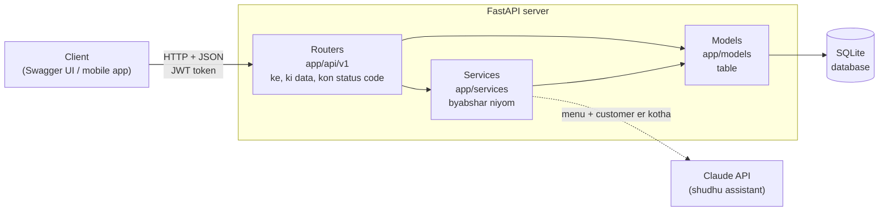
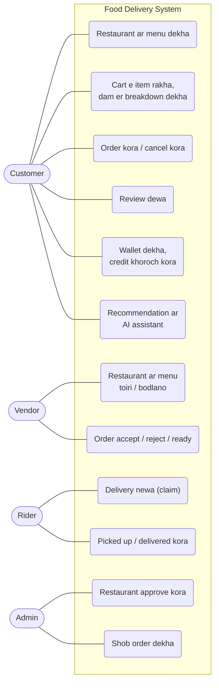
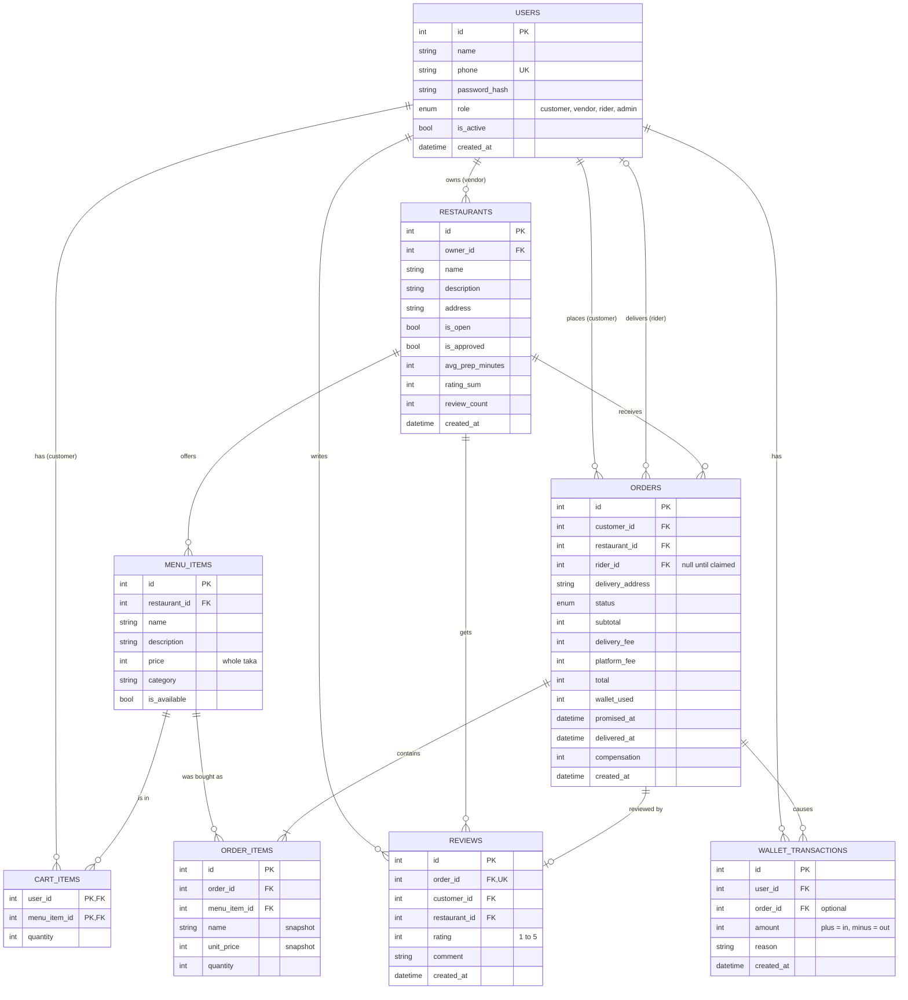
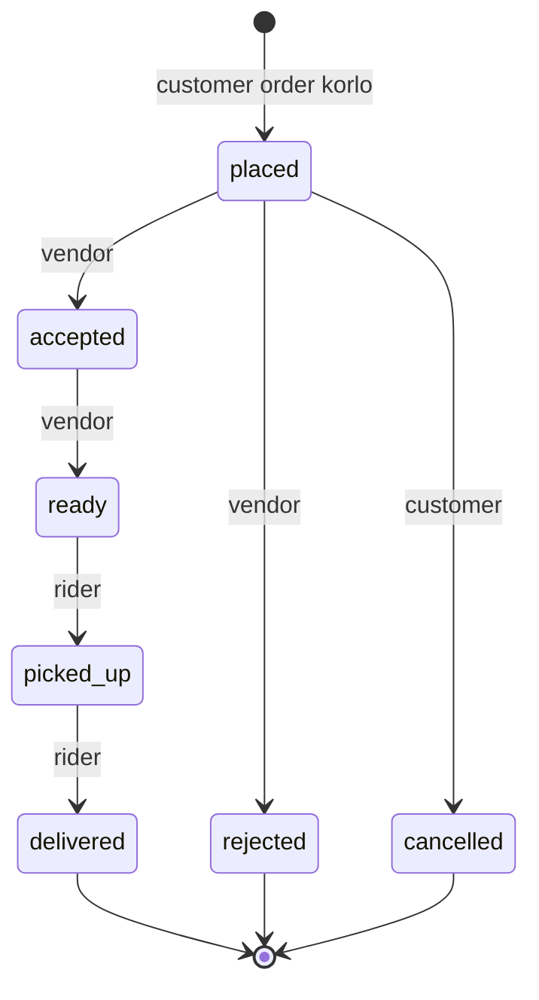

# Project Report er Upokoron

Varsity te joma dewar report, slide ar viva r jonno ja ja lage shob ekhane. Diagram gula GitHub e nije theke chobi hoye dekha jay (Mermaid). Report e boshate chaile GitHub theke screenshot nao, ba https://mermaid.live e code ta paste kore PNG namao.

## 1. Project ek nojore

| | |
|---|---|
| Naam | Food Delivery System (backend API) |
| Dhoron | REST API, 4 ta role: customer, vendor, rider, admin |
| Bhasha / framework | Python, FastAPI |
| Database | SQLite (SQLAlchemy ORM diye; PostgreSQL e jawa jay) |
| Test | 155 ta automatic test (`pytest`) |
| Bairer service | Claude API (shudhu AI assistant er jonno, optional) |

## 2. Problem statement

Bortoman food delivery app gulote user der koyekta common obhijog:

1. App er dam dokaner cheye beshi, ar checkout e giye lukano charge jog hoy
2. Khabar deri te ashe, kintu khotipuron pete support er pichone ghurte hoy
3. Review gulo bishwash kora jay na
4. Ki khabo thik korte onek shomoy jay

## 3. Amader shomadhan (unique feature)

| Feature | Ki kore | Kothay | Lesson |
|---|---|---|---|
| **Honest Price** | Cart e prothom thekei food + delivery + platform fee alada dekhay. Order e thik oi taka i kate, karon duitai ek function use kore | `app/services/pricing.py` | 5, 6 |
| **Late Compensation** | Promise kora shomoy er 15 minute er beshi deri hole customer er wallet e nije theke taka dhoke. Kono complain lage na | `app/services/compensation.py` | 9 |
| **Verified Review** | Shudhu delivered order er customer, ek order e ek bar | `app/api/v1/reviews.py` | 8 |
| **"Tomar jonno"** | Age r order ar restaurant er rating dekhe item sajay, karon shoho | `app/services/recommend.py` | 10 |
| **Banglish AI Assistant** | "500 takar moddhe 2 jon er jhal kichu" bolle menu theke bachhe. Model shudhu id dey, dam database theke | `app/services/assistant.py` | 11 |
| **Restaurant approval** | Admin approve na korle restaurant e order kora jay na | `app/api/v1/admin.py` | 7 |

## 4. System architecture



Tin ta stor:

| Stor | Folder | Dayitto |
|---|---|---|
| Router | `app/api/v1/` | HTTP: ke request korlo, data thik kina, kon status code |
| Service | `app/services/` | Byabshar niyom: dam, order er dhap, compensation, recommendation |
| Model | `app/models/` | Database table |

## 5. Use case diagram



Er baire shob role **login** kore. Customer, vendor ar rider nije register korte pare; admin shudhu server er script diye toiri hoy.

## 6. ER diagram



8 ta table. Design er bishesh dik gula:

| Dik | Kothay | Lesson |
|---|---|---|
| Composite primary key | `cart_items (user_id, menu_item_id)` | 5 |
| Snapshot (dam copy kora) | `order_items.name`, `unit_price`; `orders` er 4 ta dam | 6 |
| Unique constraint diye niyom | `users.phone`, `reviews.order_id` | 3, 8 |
| Denormalization (cholti hishab) | `restaurants.rating_sum`, `review_count` | 8 |
| Ledger (balance column nai) | `wallet_transactions` | 9 |
| Taka shob shomoy `int` | shob dam er column | 4 |

## 7. Order er state diagram



Rider `accepted` ba `ready` obosthay order ta claim kore (status bodlay na, shudhu `rider_id` boshe). `delivered` er muhurte Late Compensation hishab hoy. `rejected` / `cancelled` e khoroch kora wallet credit ferot jay.

## 8. API er talika

Shob path er age `/api/v1`. Live documentation: server chaliye `/docs`.

| Dol | Method + path | Ke | Kaj |
|---|---|---|---|
| Auth | `POST /auth/register` | shobai | Account khola |
| | `POST /auth/login` | shobai | Token newa |
| | `GET /auth/me` | login kora | Nijer tothyo |
| Restaurant | `GET /restaurants` | shobai | Approved list, search |
| | `GET /restaurants/mine` | vendor | Nijer gula |
| | `GET /restaurants/{id}` | shobai | Ekta |
| | `POST /restaurants` | vendor | Toiri |
| | `PATCH /restaurants/{id}` | malik | Bodlano |
| Menu | `GET /restaurants/{id}/menu` | shobai | Menu |
| | `POST /restaurants/{id}/menu-items` | malik | Item jog |
| | `PATCH /menu-items/{id}` | malik | Item bodlano |
| Cart | `GET /cart` | customer | Cart + dam er breakdown |
| | `PUT /cart/items/{menu_item_id}` | customer | Quantity set |
| | `DELETE /cart/items/{menu_item_id}` | customer | Item shorano |
| | `DELETE /cart` | customer | Khali kora |
| Order | `POST /orders` | customer | Order kora |
| | `GET /orders` | login kora | Nijer order (role onujayi) |
| | `GET /orders/available` | rider | Rider lagbe emon order |
| | `GET /orders/{id}` | jukto jon | Ekta order |
| | `POST /orders/{id}/claim` | rider | Delivery newa |
| | `PATCH /orders/{id}/status` | dhap onujayi | Porer dhape newa |
| Review | `POST /orders/{id}/review` | customer | Review dewa |
| | `GET /restaurants/{id}/reviews` | shobai | Review pora |
| Wallet | `GET /wallet` | customer | Balance + itihash |
| AI | `GET /recommendations` | customer | "Tomar jonno" |
| | `POST /assistant/suggest` | customer | Banglish assistant |
| Admin | `GET /admin/restaurants` | admin | Shob restaurant |
| | `PATCH /admin/restaurants/{id}` | admin | Approve / batil |

## 9. Security

| Ki | Kivabe | Lesson |
|---|---|---|
| Password | bcrypt hash + salt, plain kokhono save hoy na | 3 |
| Login | JWT token, 60 minute meyad, `SECRET_KEY` shudhu `.env` e | 3 |
| Role | `require_role` dependency, na mille `403` | 4 |
| Malikana | Onner restaurant `403`, onner order `404` | 4, 6 |
| Admin | API diye banano jay na, shudhu server er script | 7 |
| Client er pathano field | `owner_id`, `is_approved`, `role: admin` schema tei nai | 4, 7 |
| Race condition | Guarded `UPDATE ... WHERE`, unique constraint, `column = column + 1`, row lock | 3, 6, 7, 8, 9 |
| LLM | Shudhu id ney, dam database theke; rate limit; message er shima | 11 |

## 10. Testing

```bash
python -m pytest -v
```

| Dhoron | File | Ki check kore |
|---|---|---|
| Unit | `test_pricing.py`, `test_compensation.py`, `test_order_rules.py`, `test_recommend.py`, `test_assistant.py` er prothom ongsho | Ekta function, database chhara |
| API | baki shob | Request theke database porjonto puro rasta |

Report e `python -m pytest -v` er output er screenshot dio. AI assistant er test e ashol Claude API call hoy na, ekta nokol function boshano hoy (mocking).

## 11. Shimabaddhota (shot bhabe bolo)

Viva te egula nije theke bolle bhalo dekhay:

1. **Frontend nai.** Shudhu API; demo Swagger UI diye
2. **Shudhu Cash on Delivery.** bKash / Nagad nai
3. **Delivery fee flat** (40 taka). Location nai, tai duroto onujayi na
4. **Live tracking nai.** Rider er obosthan jana jay na
5. **SQLite.** Ek shathe onek lekha shamlate pare na; boro hole PostgreSQL
6. **Migration tool nai.** Table bodlale development e database file muchte hoy (Alembic lagbe)
7. **Refresh token nai.** 60 minute por abar login
8. **Rider claim kore na ele** order atke thake
9. **Compensation platform dey**, ke deri korlo (restaurant na rider) ta mapa hoy na
10. **Rate limiter memory te**, server restart e muche jay
11. **Recommendation rule-based**, machine learning na
12. **AI assistant e taka lage**, ar vendor er lekha menu diye model ke probhabito korar jhuki puro jay na

## 12. Future work

- Mobile app (Flutter / React Native) ar admin panel
- bKash / Nagad / SSLCommerz payment
- Location, duroto onujayi delivery fee, kacher restaurant
- WebSocket diye live order tracking
- PostgreSQL + Alembic + Docker diye deploy
- Phone OTP login, refresh token
- Photo diye 1-tap refund
- Group order + split bill
- Home chef + tiffin subscription
- Order er data jomle ML diye ETA ar recommendation
